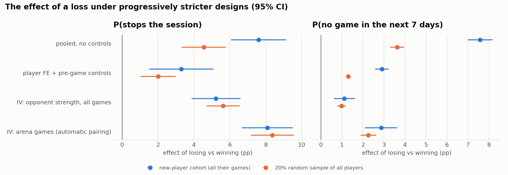
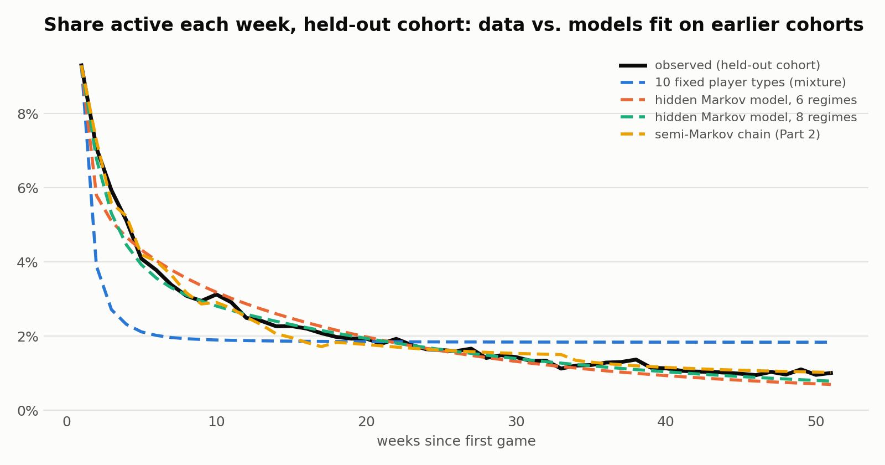

# Why do new players quit? Player lifecycle and causal churn analysis on Lichess

Most new players in an online game leave within days. The common explanation is frustration:
early losses, losing streaks, "tilt". This project tests that explanation on **6.8 million rated
Chess960 games** from the public [Lichess database](https://database.lichess.org/) (18 months,
380K players, a cohort of 44K new players). It asks three questions:

- **What does the player lifecycle actually look like?**
- **Do losses *cause* players to quit,** or do weaker players just lose more *and* quit more?
- **Is the obvious fix, easier first matches for newcomers, worth an A/B test?**

## Key findings

1. **Retention is front-loaded and engagement is not Markov.** 38.6% of new players play once and never
   return, and only 9.6% are active in their second week. A 6-regime hidden Markov model (Onboarding,
   Gone, Lapsed, Casual regular, Burst, Core), with EM written from scratch, reproduces a held-out
   cohort's retention curve. It needs 47 parameters, where a semi-Markov chain uses 412. Mixtures of up
   to 10 fixed player types cannot reproduce it.
2. **Most of "losses drive churn" is selection, and there is no tilt.**
   - Comparing each player only with themselves (player fixed effects) cuts the link between a loss and
     a week-long absence by about 60%.
   - Using only losses caused by tougher pairings (opponent strength as an instrument), a loss ends the
     session (+5 to +8 points) but raises week-long absence by only about 1 point.
   - A loss after two straight losses hurts no more than a first loss.
   - The real effect is on newcomers: **+3.5 points of week-long absence per loss in a player's first
     ten games**, on a 21% base.
3. **The obvious A/B test is not worth running, and the data point to a better one.**
   - A natural experiment (arena first opponents, which the system assigns) shows that easier first
     matches raise games played but not returning on later days.
   - Detecting the plausible lift would take more than 10 years of Chess960 newcomers.
   - 56% of the players who would absorb the extra losses are newcomers themselves.
   - The redesigned test targets a larger gap: newcomers whose first arena opponent is another newcomer
     return 3.4 points less often. The plan includes group-sequential monitoring and SRM checks,
     validated by A/A replays on real players (daily peeking: 25.5% false positives; weekly
     O'Brien-Fleming: 4.3%).



## The analysis, part by part

| Part | Question | Methods | Report |
|---|---|---|---|
| 1 | How quickly do new players leave, and what does their first day predict? | Cohort retention (D1/D7/D30, weekly), Wilson CIs, stratified comparisons | [Retention](reports/01_retention.md) |
| 2 | How do players move between Inactive, Casual and Engaged weeks? | Multi-state model: multinomial logit per origin state, player-clustered SEs, delta-method effects; test of the Markov assumption; out-of-sample checks | [Engagement states](reports/02_engagement_states.md) |
| 3 | Is the non-Markov behaviour habit, fixed player types, or changing regimes? | Mixture of Markov chains vs. hidden Markov models, both fit by EM in NumPy; BIC, held-out likelihood, model-implied duration curves | [Habit vs. player types](reports/03_habit_vs_player_types.md) |
| 4 | Do losses cause quitting? | Player fixed effects, pre-game controls, balance tests, 2SLS with opponent strength as the instrument, heterogeneity by experience | [Losses and quitting](reports/04_do_losses_cause_quitting.md) |
| 5 | Is "protected first matches" worth an A/B test? | Natural experiment, power analysis, two-sided interference, pre-registration, O'Brien-Fleming monitoring, A/A and A/B replays, SRM detection | [Experiment design](reports/05_experiment_design.md) |



## What is implemented here

- **Data engineering.** Streaming decompression of 2.2 GB of monthly `.pgn.zst` dumps that parses
  headers only (about 6 s per month), with DuckDB SQL building player–game, session, player and
  player–week tables (13M rows) in about a minute.
- **Estimators written from scratch in NumPy:**
  - fixed-effects OLS and 2SLS with cluster-robust standard errors;
  - a demean-once design that solves every model from one cross-product matrix, so 2.5M rows fit in
    the RAM of a laptop;
  - EM for mixtures of Markov chains and for hidden Markov models (scaled forward–backward);
  - Lan–DeMets O'Brien–Fleming boundaries.
- **Tests.** `tests/test_estimators.py` checks the estimators against textbook answers: dummy-variable
  regression, manual 2SLS, and brute-force likelihoods summed over every hidden path.
  `tests/test_pipeline.py` checks every derived feature on a hand-made PGN with known values.

## Reproduce

Python 3.10+. The whole pipeline runs on a laptop in about 10 minutes, after the download.

```bash
pip install -r requirements.txt

# Data: 18 months of rated Chess960 games (~2.2 GB). On macOS you can double-click download_data.command.
python src/download.py --variant chess960 --start 2025-04 --end 2026-09 --out data/raw
python src/parse_headers.py data/raw/*.pgn.zst --out data/games      # headers only -> Parquet
python src/build_panel.py --games data/games --out data/panel        # DuckDB -> analysis tables

# Analyses: each writes reports/tables/*.csv and reports/figures/*.png
python src/retention.py   --panel data/panel --out reports           # Part 1
python src/transitions.py --panel data/panel --out reports           # Part 2
python src/segments.py    --panel data/panel --out reports           # Part 3
python src/tilt.py        --panel data/panel --out reports           # Part 4
python src/experiment.py  --panel data/panel --out reports           # Part 5

# Tests
python tests/test_pipeline.py
python tests/test_estimators.py
```

Long-running scripts cache finished pieces. `--time-budget SECONDS` stops cleanly, and rerunning the
same command continues from where it stopped.

## Repository layout

```
src/
  download.py, parse_headers.py, build_panel.py   data pipeline
  retention.py                                    Part 1
  transitions.py                                  Part 2
  segments.py                                     Part 3 (mixture of Markov chains, HMM)
  tilt.py                                         Part 4 (fixed effects, 2SLS)
  experiment.py                                   Part 5 (natural experiment, power, simulations)
reports/
  01_retention.md ... 05_experiment_design.md     write-ups
  figures/  tables/                               every chart and every number behind the write-ups
tests/
```

## Data and limitations

- **Data.** The Lichess open database (CC0). Only aggregate results are reported; no individual player
  is profiled.
- **Why Chess960.** A month of standard chess is about 20 GB compressed; a month of Chess960 is about
  120 MB. The pipeline runs unchanged on `--variant standard`.
- **"Quitting" is mode-level.** A player who stops playing Chess960 may still play other Lichess modes,
  much like mode-level retention in multi-mode games.
- **No monetization data.** There are no payments or LTV. With company data, the same framework would
  add payer conversion and revenue retention.
- **Each report states its own caveats.**
