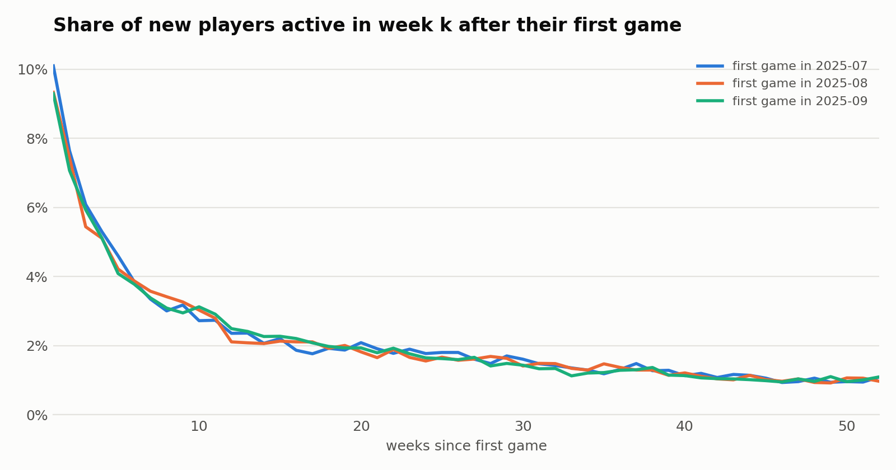
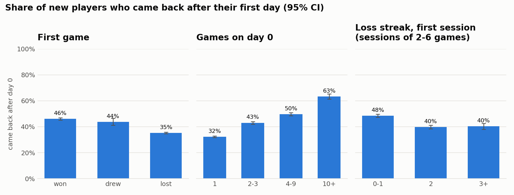
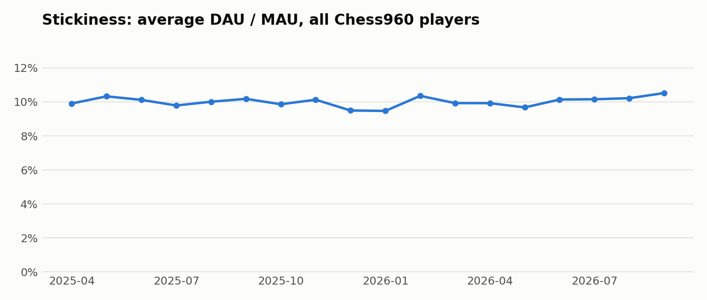

# Part 1: Retention of new Chess960 players

**Data.** 18 months of rated Chess960 games on Lichess (Apr 2025 – Sep 2026): 6.82M games.
149,614 games involving bot accounts were dropped, along with 11,227 unfinished games.
**Cohort.** 43,938 new players whose first game came in Jul–Sep 2025, after a 3-month burn-in, and who
started at the provisional 1500 rating. Every cohort player has at least 52 full weeks of follow-up.

All numbers below come from `python src/retention.py`. The CSVs behind them are in `reports/tables/`.

## Headline numbers

| Metric | Value |
|---|---|
| Played only one game, ever | 38.6% |
| Median lifetime games | 2 |
| D1 / D7 / D30 retention (played on that exact day) | 7.4% / 3.3% / 1.3% |
| Came back on any later day | 39.0% |
| Active in week 1 / week 4 after first game | 9.6% / 5.2% |
| Played at all after day 90 | 18.2% |

The three monthly cohorts are almost indistinguishable: week-1 activity is 10.1%, 9.3% and 9.3%.
The curve is therefore a stable property of the mode, not a seasonal effect.

Retention falls steeply for about 12 weeks, then flattens: 3% of players are active in week 8,
1.7% in week 26 and 1.1% in week 52. The loss is concentrated at the very start. If we condition on
players who came back at least once (n = 17,123), week-1 activity is 24.6% and week-12 activity is 5.9%.
That is 2.5× the unconditional rate, so the first return visit is the main gate.

## What the first day predicts

**First game result.** New players lose 64.7% of their first games and win only 32.3%. Those who won came back
46.1% of the time; those who lost came back 35.2% of the time. Losers also faced somewhat stronger
opponents (mean pre-game expected score 0.43 vs 0.49). Comparing within opponent-strength bands, the
won-minus-lost gap is **+11.8 points (95% CI 10.8 to 12.8)**, and it appears in every band.

**Volume on day 0.** Players who played one game on day 0 came back 32% of the time. Those who played 10 or more
came back 63% of the time. This is the strongest single predictor, but it is mostly a marker of interest,
not a lever: volume is part of the same engagement we are trying to predict.

**Losing streaks in the first session.** A streak of 3 requires at least 3 games, so the comparison is
made within session-length bands. For first sessions of 2–3 games, the return rate drops from 47.8%
(streak 0–1) to 38.2% (streak 2) and 37.9% (streak 3+). For sessions of 4–6 games, it drops from 50.3% to
44.4% and 41.6%. For players who played 7 or more games in their first session, there is no difference
(48.5%, 52.1%, 49.4%). Committed players seem to absorb early losses, while casual triers do not.

**Other cuts.** The way the first game was lost (on time vs otherwise) makes no difference
(34.6% vs 35.4%). A first game inside a tournament goes with lower return (35.2% vs 40.5%). These
players also faced stronger opponents (expected score 0.42 vs 0.46).

## Platform engagement

| | |
|---|---|
| Average DAU | 3.5k–4.7k |
| MAU | 34k–47k |
| Stickiness (avg DAU / MAU) | 9.5%–10.5%, flat over 18 months |
| Sessions: median games, share with a single game | 2 games, 47% |

## Caveats

- **Correlation, not causation.** Every newcomer starts at 1500, so their true skill is unobserved.
  Stronger newcomers both win more and may enjoy the game more. The opponent-strength adjustment
  removes the matchmaking part of the confound, but not this one. The within-player design in Part 4 and
  an experiment (below) are how to get closer to causal answers.
- **Mode-level churn.** A player who stops playing Chess960 may still be playing standard chess on Lichess.
- **Session length.** Session length is measured from the start of the first game to the start of the last
  game, so single-game sessions have length 0.

## What this suggests testing

New players lose about two thirds of their first games. That suggests the 1500 starting rating overrates
the typical newcomer, and losing early goes with not coming back. A natural experiment to test (Part 5):
**seed newcomers' first few pairings against other provisional or slightly weaker players**. The primary
metric would be came-back-after-day-0. Guardrails would be newcomer rating convergence speed and queue wait time.
