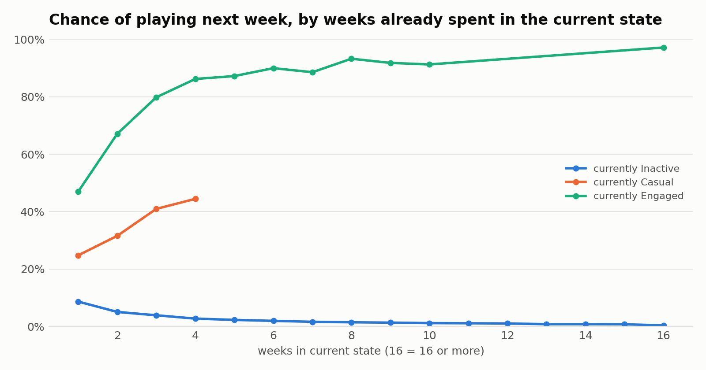
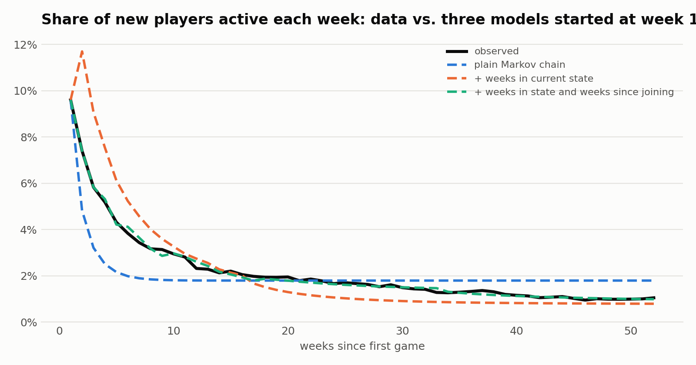
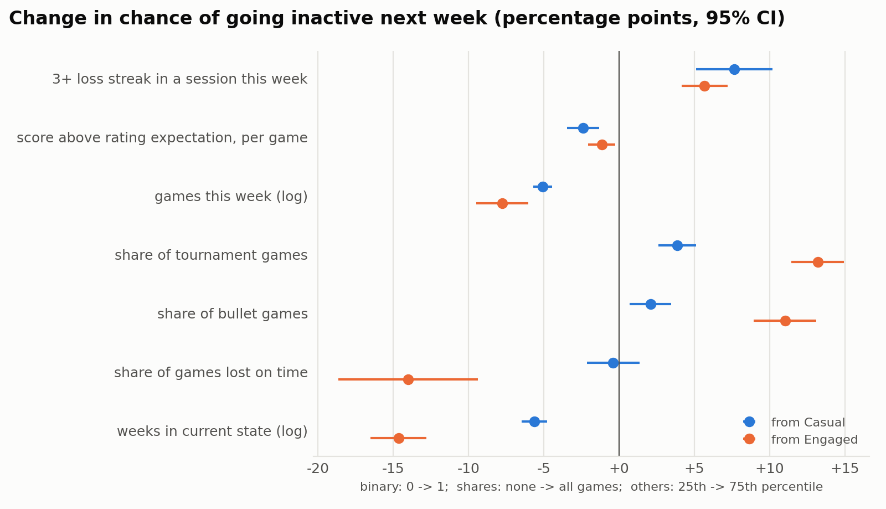

# Part 2: Engagement states and what moves players between them

**Question.** Once a new player is past day 0, how do they move between engagement levels week to week,
and what in a week's play predicts dropping out the next week?

**States**, per player-week since their first game:

| State | Definition | Share of active weeks (week 1+) |
|---|---|---|
| Inactive | 0 games | – |
| Casual | 1–4 games | 64% |
| Engaged | 5+ games (about the 60th percentile of active weeks) | 36% |

**Data.** 43,938 new players (see Part 1), 2.47M week-to-week transitions from week 1 onward.

**Model.** Every week is observed, so this is a discrete-time multi-state model rather than
R's continuous-time `msm`. The baseline is the empirical transition matrix. Covariate effects come from
one multinomial logit per origin state, predicting next week's state from this week's play, with standard
errors clustered by player. Effects are reported as average changes in probability (percentage points)
for an interpretable contrast, with delta-method 95% CIs. Code: `src/transitions.py`.

## 1. The weekly transition matrix

| from \ to | Inactive | Casual | Engaged |
|---|---|---|---|
| **Inactive** | 98.9% | 0.8% | 0.2% |
| **Casual** | 72.7% | 19.6% | 7.8% |
| **Engaged** | 34.6% | 16.8% | 48.5% |

Casual is not a stable middle ground: almost three quarters of casual weeks are followed by an inactive
week. Engaged players stay engaged about half the time. That is about 2 consecutive weeks on average
if transitions were memoryless, but as section 2 shows, they are not. Only 11.5% of the cohort reaches
Engaged at any point after their first week.

## 2. The Markov assumption fails, and the model that works

A Markov chain assumes next week depends only on the current state. The data say otherwise.
Players who have been **Engaged for 1 week** play again the next week 47% of the time; after **4 weeks**,
86%; after **16+ weeks**, 97%. In the other direction, an **Inactive** player's weekly chance of returning
falls from 8.7% after one quiet week to 2.7% after four, and to about 1% after twelve. Habits harden on both sides.

To test which memory the process needs, I propagated three chains forward from the observed week-1
distribution and compared them with the actual share of players active each week:

| Chain | Mean abs. error, weeks 2–52 (in-sample) | Holdout: fit on Jul–Aug starters, predict Sep starters |
|---|---|---|
| Plain Markov (one matrix) | 0.71 pp | 0.74 pp |
| + weeks in current state | 0.64 pp | 0.61 pp |
| + weeks in state **and** weeks since joining | **0.08 pp** | **0.12 pp** |

The plain chain drops too fast and then settles at a 1.8% floor that the data keep falling below. Adding
time-in-state alone overshoots early: a player who just went quiet in week 1 is not the same as a veteran
taking a week off. Conditioning on both reproduces the curve almost exactly, including on a cohort it
never saw. **Engagement is a semi-Markov process.** Both how long you have been in a state and how long
ago you joined matter.

## 3. What in a week predicts dropping out the next week

The model controls for time in state, tenure, lifetime games, games this week, performance, rating
change and game mix. Key effects on P(Inactive next week):

| Covariate (contrast) | From Casual | From Engaged |
|---|---|---|
| 3+ loss streak in a session this week (0 → 1) | **+7.6 pp** (5.1 to 10.2) | **+5.7 pp** (4.1 to 7.2) |
| Score above rating expectation, per game (25th → 75th pct) | −2.4 pp (−3.5 to −1.3) | −1.2 pp (−2.1 to −0.2) |
| Games this week (25th → 75th pct) | −5.1 pp | −7.8 pp |
| Weeks in current state (25th → 75th pct) | −5.6 pp | −14.7 pp |
| All games in tournaments (none → all) | +3.9 pp | +13.2 pp |
| All games bullet (none → all) | +2.1 pp | +11.0 pp |

**Losing streaks matter, and the raw data hide it.** Engaged weeks *with* a 3+ loss streak are followed
by inactivity less often in raw terms (32.5% vs 36.3%), because heavy players rack up more streaks.
Once weekly volume and the other factors are held fixed, a streak week raises next-week dropout by 5.7 points
(about +16% relative to the 35% base). The same reversal appears for lapsed players: those whose last
active week contained a streak return more often in raw terms (1.46% vs 1.05% per week), but 0.13 points
*less* often after adjustment (about −12% relative to the ~1.1% weekly return rate).

**A streak predicts dropout beyond plain bad results.** Weekly performance against expectation has a much
smaller effect than the streak itself. That points to how losses cluster mattering, not just how many there are.
This is the hypothesis Part 4 tests within players.

**Tournament- and bullet-heavy weeks are followed by more dropout.** This fits event-driven play: players
show up for an arena, then leave.

**Unexplained:** among Engaged players, weeks with a higher share of games lost on time are followed by
*less* dropout (−14 pp, wide CI). This may reflect committed fast-time-control players, but I have not verified it.

## Caveats

- **Associations, not effects of an intervention.** The covariates describe a player's own week, and
  unobserved traits (motivation, real-life schedule) drive both play patterns and dropout. Part 4 uses
  within-player comparisons to remove stable traits.
- **Casual streaks are rare.** Only 2.6% of casual weeks contain a 3+ streak, so that estimate has the widest CI.
- **Thresholds are a modelling choice.** Moving the Engaged cutoff changes the state shares, but not the
  duration dependence, which shows up for every active state.
- **The best-fitting chain is nonparametric.** It conditions on cells, not a parametric hazard. It
  describes the dynamics well, but it is not by itself an explanation; Part 3 looks for the latent player
  types that could generate it.

## Pseudo-R² of the transition models

| Origin | Weeks | Players | McFadden pseudo-R² |
|---|---|---|---|
| Engaged | 18,430 | 5,021 | 0.19 |
| Casual | 32,666 | 12,978 | 0.09 |
| Inactive | 2,423,171 | 43,927 | 0.16 |
