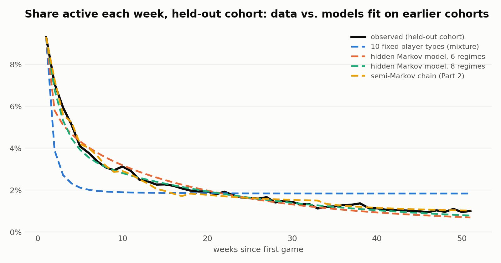
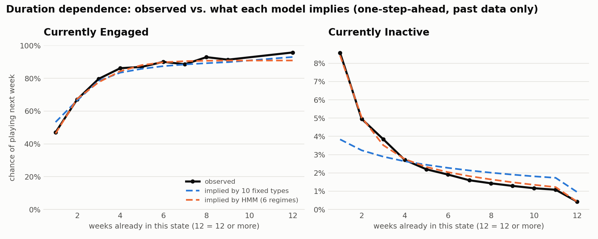
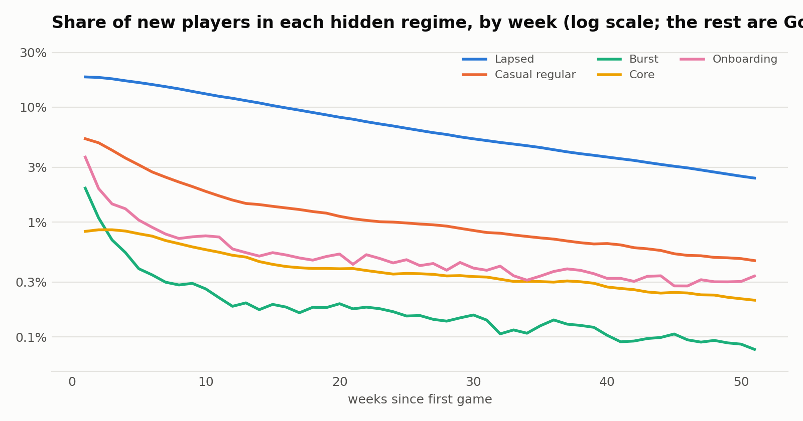

# Part 3: Habit, player types, or regimes? Explaining the non-Markov dynamics

**Question.** [Part 2](02_engagement_states.md) found strong duration dependence: the longer a player has
been in a state, the less likely they are to leave it. There are two classic explanations:

- **Habit (state dependence):** each player's own odds change the longer they stay in a state.
- **Heterogeneity (sorting):** players differ in fixed ways. Each type is a plain Markov chain, and
  over time the players left in a state are increasingly the ones who stay.

**Test.** Fit models that can only produce duration dependence through heterogeneity, and check
whether they reproduce the data:

| Model | What it allows |
|---|---|
| Mixture of K Markov chains | K fixed player types; each type is a plain Markov chain with no duration dependence |
| Hidden Markov model (HMM), K regimes | K hidden regimes with Markov dynamics that emit the observed state; players can move between regimes |
| Semi-Markov chain (Part 2) | Next state depends on state, weeks in state and weeks since joining |

Both latent models are fit by EM written from scratch in numpy (`src/segments.py`), with 4 random
restarts each. **Data:** each of the 43,938 new players' weekly states for weeks 0–51. For held-out
checks, models are fit on the Jul–Aug starters and evaluated on the Sep starters (13,605 players).
Week 0 is the onboarding week, when every player is active by construction. The mixture therefore gives
each type its own distribution over the (week 0, week 1) pair, with homogeneous transitions only after that.

## 1. Fixed player types cannot reproduce retention

| Model | Parameters | BIC | Held-out log-lik. per player | Curve error, held-out (pp) |
|---|---|---|---|---|
| Plain Markov chain | 11 | 453,535 | −5.116 | 0.77 |
| Mixture, 4 types | 47 | 417,407 | −4.689 | 0.78 |
| Mixture, 10 types | 119 | 413,915 | −4.644 | 0.78 |
| Semi-Markov chain (Part 2) | 412 | 413,344 | −4.606 | 0.13 |
| **HMM, 6 regimes** | **47** | **401,354** | **−4.496** | **0.23** |
| HMM, 8 regimes | 79 | 398,815 | −4.465 | 0.12 |

Adding fixed types keeps improving the likelihood, but **the retention curve never gets better**, even
with 10 types. The mixture fails in two specific ways:

- **Early on, it predicts too steep a drop:** in the held-out cohort, 3.9% of players active in week 2, against an observed 7.1%.
- **Later, it settles on a floor of about 1.8%,** while real activity keeps falling to 1.0% by week 51.

A player locked into a type never quits for good. Real players do.

The HMM matches the curve with as few as 3 regimes. From 4 regimes on, it beats the step-4 semi-Markov
chain on both BIC and held-out likelihood, with a tenth of the parameters. BIC is still falling at
8 regimes. I interpret **6 regimes** because each one is a distinct, readable lifecycle stage and it
already reproduces the duration curves (section 2). Eight regimes split those stages further for a
small gain in fit.

## 2. Where the duration dependence comes from

Each model was asked for its one-step-ahead chance that a player plays next week, using only that
player's past weeks. These predictions were then averaged by current state and weeks in that state:

| Weighted error vs. observed duration curve | 10 fixed types | HMM, 6 regimes |
|---|---|---|
| Currently Engaged | 3.66 pp | 1.16 pp |
| Currently Casual | 2.96 pp | 1.64 pp |
| Currently Inactive | 0.69 pp (on a 1–9% scale) | **0.05 pp** |

The answer differs by side:

- **Engaged side: mostly sorting.** Fixed types alone reproduce most of the rise from 47% to 96%. The longer
  someone stays engaged, the more evidence they are a stayer. This is learning *who* the player is, not the
  player changing. The main miss is in a spell's first week, where fixed types are too optimistic (53% vs 47%).
- **Inactive side: real change.** Fixed types cannot produce how fast the chance of returning decays: 8.6%
  after one quiet week, 2.7% after four, and 0.4% after twelve or more. The decay is too steep for any mix
  of fixed types. The HMM matches it because players actually move from *Lapsed* into an absorbing
  *Gone* regime. **Quitting is an event that happens to a player, not a type they always were.**

Neither pure explanation is right. The process is best described as **persistent but not permanent
regimes**: stable enough that time in a state reveals the regime (sorting), and changing enough that
lapsed players eventually leave for good.

## 3. The six regimes

| Regime | Starts here | What it looks like | Stays each week | Main exits | Avg. weeks in regime |
|---|---|---|---|---|---|
| **Onboarding** | 92.3% | active every week (86% casual) | 4% | → Gone 75%, → Lapsed 18% | 1.0 |
| **Gone** | – | never active | 99.8% | absorbing (0.2%/wk restart) | – |
| **Lapsed** | – | active in 4% of weeks | 91.4% | → Onboarding-like restart 3.5%, → Gone 3.0% | 11.6 |
| **Casual regular** | – | active in 49% of weeks | 75.6% | → Lapsed 14.6% | 4.1 |
| **Burst** | 6.8% | engaged 88% of weeks | 32.9% | → Casual 33%, → Lapsed 21%, → Gone 8% | 1.5 |
| **Core** | 0.9% | engaged 88% of weeks | 90.3% | → Casual 8.3%, → Gone 1.4% | 10.4 |

- **Most new players exit onboarding straight to Gone.** 73% are most likely Gone by week 1, and 16% Lapsed.
- **Lapsed is the main battleground.** 22% of players pass through it, and 25% of those later return to
  an active regime. Each week, 3% of the Lapsed pool drains into Gone, which is effectively permanent.
- **Core and Burst look identical in any single week** (88% engaged), but they are different players.
  Burst lasts about 1.5 weeks; Core lasts about 10.

**Who goes where after onboarding** (most likely regime at week 1, profiled by week-0 play):

| After onboarding | Share | Week-0 games (median) | Week 0 engaged | Score vs. rating expectation, per game | Active weeks 1–51 (mean) | Still active, weeks 12–15 |
|---|---|---|---|---|---|---|
| Gone | 72.9% | 1 | 15% | −0.16 | 0.1 | 0% |
| Lapsed | 15.9% | 2 | 22% | −0.13 | 2.6 | 21% |
| Casual regular | 4.4% | 5 | 55% | −0.04 | 6.6 | 28% |
| Burst | 2.0% | 14 | 94% | +0.02 | 5.7 | 18% |
| Core | 0.7% | 27 | 95% | +0.04 | 22.0 | 67% |

Core starters play about twice as many week-0 games as Burst starters (median 27 vs 14). Those who end
up Gone underperform their rating expectation the most in week 0. This is consistent with Part 1's
finding that early losses predict leaving.

## 4. How early can we tell who will still be playing?

Held-out cohort: the HMM was fit on earlier starters, and the target is any game in weeks 12–15 (base rate 6.1%).

| Weeks observed | HMM AUC | "Games so far" AUC | Hit rate in HMM's top 10% |
|---|---|---|---|
| 0 | 0.59 | 0.63 | 11.7% |
| 0–2 | 0.67 | 0.67 | 19.4% |
| 0–4 | 0.71 | 0.69 | 22.2% |
| 0–8 | 0.74 | 0.72 | 26.2% (4.3× base) |

To be candid: on its own, the HMM is a **segmentation and explanation tool, not a strong predictor**.
It only sees three coarse states per week, so it barely beats simply counting games played. A churn
prediction model would use the regime probabilities as features alongside game counts, results and
streaks.

## Implications

- **Reactivation timing.** A lapsed player's weekly chance of coming back falls fast, and the Lapsed
  pool drains into Gone at 3% a week. Win-back effort is worth the most in the first few weeks of a lapse.
- **A return looks like a restart.** Lapsed players who come back pass through an onboarding-like
  regime again, so returning players may benefit from the same first-week experience as new ones.
- **Don't read one big week as commitment.** A heavy first week is a Burst far more often than Core
  (2.0% vs 0.7% of players). Programs aimed at "engaged newcomers" should look at the second and third weeks, not only the first.

## Caveats

- **Choice of K.** BIC prefers the largest HMM tried (8 regimes). Six regimes is a readability choice,
  checked against the duration curves and the held-out curve. The 7-regime fit landed in a worse
  configuration on the engaged side, a reminder that EM finds local optima.
- **Regime names are interpretations** of fitted emission and transition probabilities, assigned by a rule in the code.
- **Late-curve fit.** The 6-regime HMM slightly underpredicts activity a year out (0.7% vs 1.0% at week 51);
  the 8-regime fit and the semi-Markov chain do better there.
- **Weekly states are coarse.** Within-week intensity and results enter only through Part 2's covariates.
- **Mode-level quitting.** "Gone" means gone from Chess960; the player may still play other modes on Lichess.
