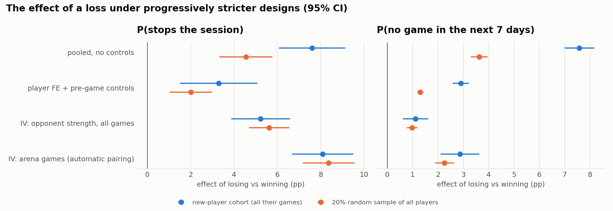
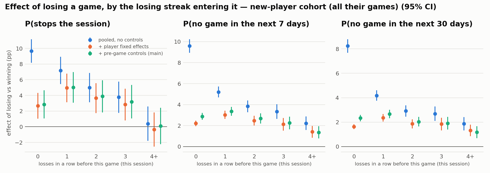
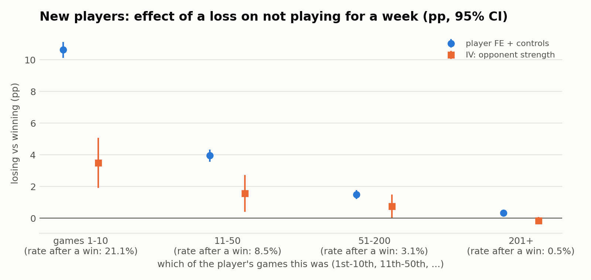

# Part 4: Do losses cause players to quit? Within-player causal tests

**Question.** [Part 2](02_engagement_states.md) found that a week containing a 3+ losing streak is followed by
5.7 points more dropout among engaged players. That comparison is across players and weeks, so it is
open to confounding. Weaker or less committed players lose more *and* quit more; a bad, tired day
produces both losses and stopping. Does losing actually *cause* players to stop? And is there
"tilt", meaning each extra loss in a row hurts more than the last?

**Unit of analysis.** Every game a player finished, with three outcomes measured right after it:

| Outcome | Definition | Rate after a win: new players / all players |
|---|---|---|
| Stops the session | no game in the next 30 minutes | 28.8% / 26.4% |
| Quits for a week | no game in the next 7 days | 6.6% / 3.8% |
| Quits for a month | no game in the next 30 days | 4.8% / 2.4% |

Games in the last 30 days of the data are dropped, so every outcome uses the same games. Abandoned
games are excluded.

**Samples.**
- The 43,938 new players from Parts 1–3, with all their games (678,355 games from the 26,609 who played at least twice).
- A 20% random sample of all players, mostly experienced (2.49M games, 47,027 players).

Code: `src/tilt.py`. The fixed-effects and 2SLS estimators are written in numpy and checked against
dummy-variable regressions. Standard errors are clustered by player throughout.

## The identification strategy

Each design removes one more source of bias:

1. **Pooled.** Compare games that were lost with games that were won.
2. **Player fixed effects.** Compare a player only with themselves. This removes skill, motivation and
   habits, and everything else that is stable about the player.
3. **+ pre-game controls (main design).** Hold fixed everything known before the game starts:
   - **The losing streak entering the game.** Both arms share the same history and differ only in
     this game's result. This also removes selection into long streaks.
   - **The Elo-expected score from both ratings.** Given ratings, the result is mostly luck and short-run form.
   - **Context:** position and minutes into the session, games played so far, own rating, speed,
     tournament or not, and hour-of-day and day-of-week dummies. With player fixed effects, UTC hour
     stands in for local time of day, since each player's time zone is fixed.
4. **Instrumental variable.** Use only the part of the result caused by *who you were paired with*.
   The instrument is the expected score, and own rating is held fixed. This also removes short-run
   form, because a player's form does not change their opponent's rating. It is cleanest in arena
   tournaments, where the system assigns opponents. In casual games, players pick opponents from a
   list of seeks, so the choice can reflect their mood.

**Balance check.** If, given these controls, a loss is as good as random, then pre-game signs of
fatigue should not predict it. They do not. Minutes since the previous game, minutes into the session
and position in the session all have loss coefficients within ±0.003 SD (p > 0.2) in both samples.
The one imbalance is rating. Within a player, losses come when their rating sits above their usual
level: +30 points for new players, +16 for all players. This is Elo noise reverting to the mean.
Own rating is therefore a control, and the IV does not rely on it.

## 1. Most of the raw association is selection

Effect of losing vs winning a game, in percentage points:

| | Pooled | Player FE + controls | IV, all games | IV, arena games |
|---|---|---|---|---|
| **New players:** stops session | +7.6 | +3.3 (1.5 to 5.1) | +5.2 (3.9 to 6.6) | +8.1 (6.7 to 9.5) |
| **New players:** quits for a week | +7.6 | +2.9 (2.6 to 3.2) | +1.1 (0.6 to 1.6) | +2.9 (2.1 to 3.6) |
| **New players:** quits for a month | +6.4 | +2.3 (2.1 to 2.6) | +0.7 (0.2 to 1.1) | +2.1 (1.5 to 2.8) |
| **All players:** stops session | +4.6 | +2.0 (1.0 to 3.0) | +5.6 (4.7 to 6.6) | +8.4 (7.2 to 9.6) |
| **All players:** quits for a week | +3.6 | +1.3 (1.2 to 1.4) | +1.0 (0.8 to 1.2) | +2.3 (1.9 to 2.6) |
| **All players:** quits for a month | +3.0 | +1.0 (0.9 to 1.1) | +0.6 (0.4 to 0.8) | +1.4 (1.1 to 1.6) |

First-stage F-statistics are above 10,000 in every IV model.

- **Comparing players with themselves cuts the week-level effect by about 60%** (7.6 → 2.9 for new players).
  Much of "losers quit" is "players who lose a lot are players who quit".
- **Losing causes players to end the session.** Every design agrees, at +2 to +8 points on a base of about 27%.
- **Losing causes a small amount of real churn.** Under the IV, a loss raises the chance of not
  playing for a week by about 1 point overall and 2–3 points in arenas, on bases of 4–7%. That is
  smaller than the fixed-effects estimate. Part of that estimate is short-run form, which the
  pre-game controls cannot see.
- **In casual games the IV finds no week-level effect**, but there the opponent is chosen. Choosing a
  tougher opponent may itself signal confidence, which would bias the IV toward zero. The arena
  estimates, where pairing is automatic, are the ones to trust.

## 2. No tilt: a loss on a streak does not hurt more

Effect of losing this game vs winning it, by how many losses in a row came before it (new players, main design):

| Losses in a row before the game | 0 | 1 | 2 | 3 | 4+ | 2+ minus 0 |
|---|---|---|---|---|---|---|
| Stops session | +2.9 | +5.0 | +3.9 | +3.2 | +0.1 | 0.0 (−1.2 to 1.2) |
| Quits for a week | +2.9 | +3.4 | +2.7 | +2.3 | +1.4 | −0.6 (−0.9 to −0.3) |
| Quits for a month | +2.3 | +2.7 | +2.0 | +1.9 | +1.2 | −0.5 (−0.8 to −0.2) |

If tilt drove quitting, the effect of a loss would grow along the streak. It does not. After two or
more straight losses, one more loss changes quitting by the same amount as a first loss, or slightly
*less*. The all-player sample shows the same pattern (week-level difference −0.3, CI −0.4 to −0.2).
A streak hurts because it is several losses, each adding about the same amount, not because the
third loss in a row is special.

Players still playing after four straight losses are in a persistent, grinding mode. Their next loss
barely moves them. That is selection on who keeps going, and it is exactly why the comparison has to
be made at a fixed entering streak.

**Raw data point the wrong way.** Quitting for a week *falls* from 12.7% after games with no losing
streak to 4.3% after games entered on a streak of 4+. Long streaks only happen inside long sessions,
and long sessions belong to committed players. A naive look would conclude that streaks keep people playing.

## 3. New players are where losses matter

New players, effect of losing vs winning on quitting for a week:

| Game number | Rate after a win | Player FE + controls | IV (opponent strength) |
|---|---|---|---|
| 1st–10th | 21.1% | +10.6 (10.1 to 11.1) | **+3.5 (1.9 to 5.1)** |
| 11th–50th | 8.5% | +4.0 (3.6 to 4.3) | +1.6 (0.4 to 2.7) |
| 51st–200th | 3.1% | +1.5 (1.2 to 1.8) | +0.8 (0.0 to 1.5) |
| 201st+ | 0.5% | +0.3 (0.2 to 0.4) | −0.2 (−0.4 to 0.1) |

For ending the session, the IV effect in the first 10 games is +8.2 points (6.5 to 10.0).

A loss in a player's first ten games causes about a 3.5-point rise in not coming back within a week,
about 17% relative to the 21% base. By the 200th game the effect is gone. This is the causal version
of Part 1's finding that new players who lose their first game return less often.

## 4. Part 2's weekly result, re-estimated within player

Linear probability model for being inactive next week, given active this week, with the same
covariates as Part 2. Effect of a 3+ losing streak in a session that week:

| Origin | Pooled | Player FE |
|---|---|---|
| Engaged (5+ games) | +6.6 (4.9 to 8.3) | **+2.4 (0.6 to 4.1)** |
| Casual (1–4 games) | +10.1 (7.0 to 13.1) | +10.8 (6.3 to 15.2), from players with 2+ casual weeks |
| Any active | +8.4 (6.9 to 9.9) | +5.4 (3.9 to 6.9) |

For engaged players, about two thirds of Part 2's estimate was between-player differences.

## What this means

- **"Losing streaks drive churn" is mostly not causal,** and "tilt" in the sense of escalating damage is
  not supported. What is causal: each loss makes a player more likely to stop for the day, and,
  for players in their first few dozen games, somewhat more likely to stay away.
- **The lever is newcomer matchmaking, and the IV measures exactly that lever.** The instrument *is*
  opponent strength. Matching a newcomer in their first 10 games against an opponent who lowers their
  loss probability by 10 points cuts their chance of disappearing for a week by about 0.35 points per
  game. Summed over the first ten games, that is a measurable but modest effect. Part 5 sizes an
  A/B test of "protected first matches" from these numbers.
- **Stopping a session is not the same as churning.** Losses end sessions in every design, but most
  of those players come back. Retention metrics should not treat a session ending after a loss as
  a warning sign for experienced players.

## Caveats

- **IV exclusion.** Opponent strength could affect quitting other than through the result: a harder game
  may be longer or more tiring, and game length is not in the header data. This would tend to inflate
  the session-level IV, which is larger than the fixed-effects estimate for session stopping. In casual
  games, opponent choice can reflect mood.
- **Arena games end on a schedule.** Session stopping in arenas partly reflects the tournament ending.
  That adds noise but not bias, because the end time does not depend on the game's result. The week-
  and month-level outcomes are unaffected.
- **Linear probability models.** Effects are average differences in probabilities, and some predicted
  probabilities near 0 or 1 fall outside [0, 1].
- **Experience in the all-player sample** counts games since April 2025, not lifetime games, so the
  experience breakdown uses only the new-player cohort.
- **Mode-level churn.** "Quitting" means no Chess960 games; the player may still play other Lichess modes.
