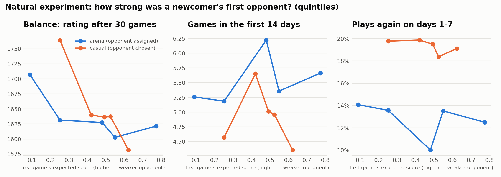
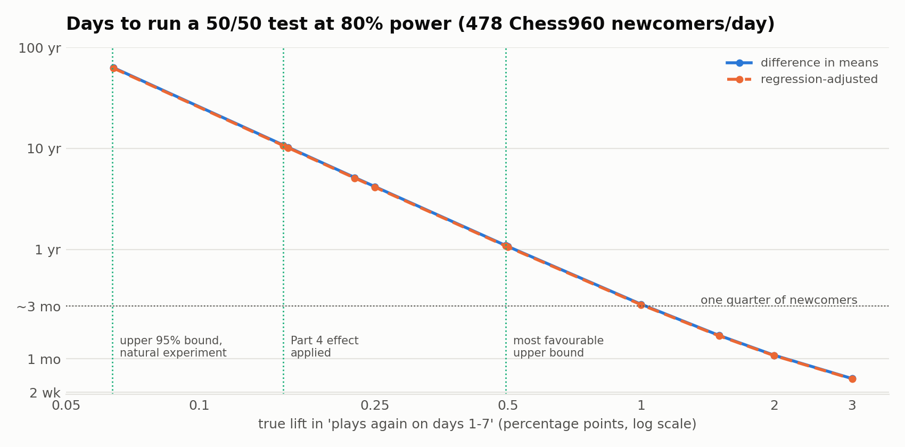
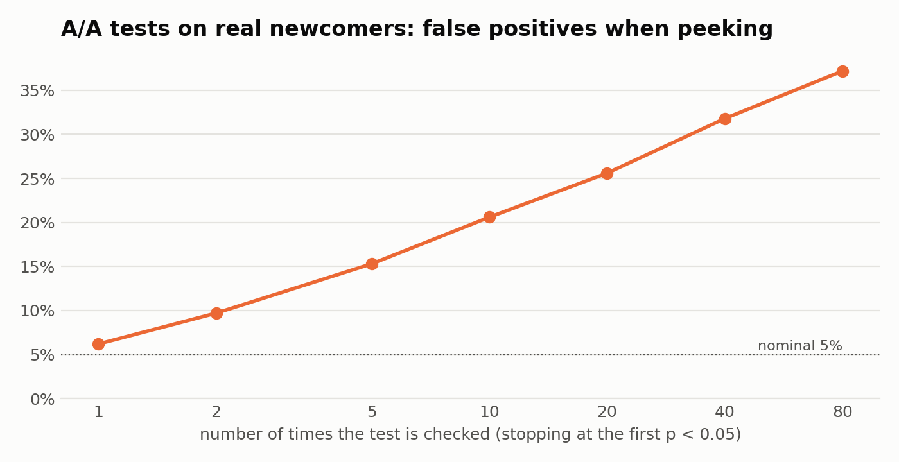

# Part 5: Should we A/B test "protected first matches"? Sizing an experiment before running it

**Context.** [Part 4](04_do_losses_cause_quitting.md) found that losses early in a player's life raise the chance they stay
away, and that the instrument behind that estimate (opponent strength) is the thing a matchmaker
controls. The natural next move is an A/B test: give new players easier first opponents and measure
retention. An experiment costs months of traffic, so this step asks two questions first. How big could
the effect be? And could a test detect it? It then writes the plan for the experiment that survives.

**Data.** The 43,938 new Chess960 players from Parts 1–4, one row each. Code: `src/experiment.py`.

**Primary metric.** Plays again on days 1–7 after the first game (17.4%).
**Secondary metrics.** Active in week 2 (9.6%), ever comes back after day 0 (39.0%), games in the first 14 days (mean 5.1).

## 1. Pre-test evidence: a natural experiment in first opponents

Every newcomer starts at 1500, so the strength of their first opponent is a draw from whoever is
available. If that draw were random, its effect on retention would be the effect of the policy,
measured for free. Whether it is random depends on how the opponent was found.

**Balance decides which source is usable.** A newcomer's rating after 30 games is a proxy for their
true skill, and one early result barely moves it, so it should not depend on the first draw.

| First game | Players | Rating after 30 games, per +0.1 expected score | Verdict |
|---|---|---|---|
| Casual (newcomer picks the opponent) | 31,375 | −36 points (−46 to −26), p < 0.001 | **Fails.** Strong players on new accounts pick strong opponents. |
| Arena (system assigns the opponent) | 12,563 | −7 points (−15 to +2), p = 0.12 | Usable. Speed choice is imbalanced, so it is controlled for. |

Pooling both would have produced a confident but wrong answer: newcomers with *easier* first
opponents return *less* (−0.28 points per +0.1 expected score), because they are weaker players.

**Arena results.** All estimates control for speed, hour, day of week and month, with robust SEs.
"Per +0.1" means per +0.1 in the first game's expected score, i.e. a somewhat weaker first opponent.

| Metric | Per +0.1 (reduced form) | Winning vs losing the first game (2SLS) |
|---|---|---|
| Games in the first 14 days | **+0.10 games (+0.01 to +0.19)** | +1.8 games (+0.3 to +3.4) |
| Plays again on days 1–7 | −0.18 pp (−0.43 to +0.07) | −3.2 pp (−7.8 to +1.3) |
| Active in week 2 | −0.19 pp (−0.39 to +0.01) | −3.5 pp (−7.2 to +0.2) |
| Ever comes back | −0.14 pp (−0.50 to +0.21) | −2.6 pp (−9.1 to +3.9) |

The first stage is +0.55 points won per unit of expected score (F = 1,124).

**A confounder inside the arena.** 51% of arena newcomers meet *another newcomer* first, since both sit
at 1500. Those players come back on days 1–7 far less often: 9.9% vs 14.6%, −3.4 points after controls
(−4.8 to −2.0). That clusters at expected score 0.5 and bends the curve above. Holding it fixed, a weaker
first opponent still shows no significant effect on returning:

| Specification | Plays again on days 1–7, per +0.1 |
|---|---|
| Controlling for "opponent is a newcomer" | +0.10 pp (−0.18 to +0.37) |
| Established opponents only (6,159 players) | +0.18 pp (−0.20 to +0.56) |

**Reading.** An easier first opponent makes newcomers play more in the short run, which matches Part 4's
session-level effect. There is no detectable effect on whether they come back on later days.
Short-term engagement and retention point in different directions here. A test powered on "games
played" would likely show a win that does not translate into retained players.

## 2. Implied effect of the policy, and who pays for it

**Policy A: protected first match.** The first opponent is never stronger than the newcomer
(expected score at least 0.5). That changes 49.6% of newcomers, raising their mean expected score by 0.088.

| Source of the estimate | Implied lift in "plays again on days 1–7" |
|---|---|
| Arena natural experiment | −0.16 pp (−0.38 to +0.06) |
| Arena, established opponents only (most favourable) | +0.16 pp (−0.18 to +0.49) |
| Part 4's newcomer effect, applied to the first game | +0.15 pp (+0.08 to +0.23) |

**Two-sided interference.** Every point a protected newcomer gains is a point their opponent loses.
Among first games against opponents rated at or below 1500, the pool a protective matchmaker would
draw from, **56% of those opponents are themselves in their first 10 games** (11% have played 11–50,
11% have played 51–200, and 22% more than 200). Weighting by Part 4's effect of a loss at each
experience level, the policy causes about 0.10 points of extra week-long absence on the other side of
the board per protected newcomer. That cancels about 60% of even the optimistic gain. Done naively,
protecting newcomers mostly moves losses from one newcomer to another.

## 3. Power: could a test detect it?

Baseline 17.4%, 478 new Chess960 players per day, two-sided α = 0.05, 80% power, 50/50 split, plus
8 days for the last enrolled players' outcome to mature.

| True lift | Players per arm | Time to run |
|---|---|---|
| +0.06 pp (upper bound, arena) | 5.5 million | ~63 years |
| +0.15 pp (Part 4 effect applied) | 940,000 | ~11 years |
| +0.49 pp (most favourable upper bound) | 93,000 | ~13 months |
| +1.0 pp | 23,000 | 104 days |
| +2.0 pp | 5,900 | 33 days |

With a full quarter of newcomers, the minimum detectable effect is about 1 point.

**Variance reduction does not help here.** CUPED needs a pre-experiment value of the metric, and brand-new
players have no history. Regression adjustment on what is known before matchmaking (speed, arena vs
casual, hour, day, month) explains R² = 1.2% of the variance, worth about 1% fewer players.

**Decision for policy A: do not run it in Chess960.** Every estimate of its effect sits below what a
year of traffic could detect. The best evidence says the effect on returning is near zero, and a
naive implementation harms the opponents. Even in a mode with 10× the newcomers, it is a low-priority test.

## 4. A testable alternative: no newcomer-vs-newcomer first arena game

The arena analysis turned up a larger gap. Newcomers whose first arena opponent is another newcomer
return 3.4 points less often. That is a correlation: newcomer-vs-newcomer pairings may concentrate in
particular arenas or times that attract one-off players. An experiment is exactly the tool for
separating the two.

**Policy B.** In arenas, never pair a newcomer's first game with another newcomer (game number ≤ 10);
pair them with an established player near their rating instead. Because established players are
robust to losses (Part 4), this also avoids the interference problem of policy A.

| Scenario | Lift among arena newcomers (intent to treat) | Players per arm | Time to run |
|---|---|---|---|
| Observed gap fully causal | +1.7 pp (3.4 × 51% affected) | 5,900 | **~95 days** |
| Half causal | +0.9 pp | 23,000 | ~11 months |
| A quarter causal | +0.4 pp | 91,000 | ~3.7 years |

Baseline among arena newcomers is 12.2%, with 137 entering per day.

Run for one quarter, the test can confirm the full gap or rule it out. A null result would mean less
than about half of the correlation is causal, which is itself a useful answer.

## 5. Experiment plan for policy B (pre-registration)

| Item | Plan |
|---|---|
| Hypothesis | Pairing a newcomer's first arena game with an established player instead of another newcomer raises the chance they play again on days 1–7. |
| Unit and assignment | New account; 50/50 by hash(account id, experiment salt), fixed at account creation. |
| Trigger | The newcomer's first game is in an arena. Analyse triggered players only. In control, log whether the matchmaker *would* have avoided a newcomer pairing, to define the same population in both arms. |
| Primary metric | Plays again on days 1–7 after the first game. |
| Secondary metrics | Active in week 2; ever comes back; games in 14 days (winsorized at the 99th percentile). Benjamini–Hochberg correction across secondaries. |
| Guardrails | Arena pairing wait time; newcomers' first-game loss rate; established opponents' 7-day return after facing a newcomer; abandoned games. |
| Duration | 87 days of enrollment plus 8 days of maturation; whole weeks only, so weekday mix is balanced. |
| Monitoring | Weekly looks against O'Brien–Fleming boundaries (Lan–DeMets spending): \|z\| > 4.65 at week 1, falling to 2.13 at the final look. No daily significance checks. |
| Health checks | Sample-ratio-mismatch test daily (alarm at p < 0.001); reconcile assignment logs with first-game records. |
| Interference | Treated newcomers no longer take other newcomers as partners, so some control newcomers also meet fewer newcomers. This dilutes the contrast (conservative). If spillover logging shows it is large, rerun with arenas as the randomization unit. |
| Novelty effects | Not applicable: new players have no previous experience to contrast against. |
| Decision rule | Ship if the primary metric's CI excludes zero and every guardrail stays within its threshold (e.g., wait time +10% at most). |

## 6. Checking the plan on the real players

The plan's statistics were replayed on the 43,938 real newcomers, in enrollment order, with random
assignment (1,000 replications each).

**A/A tests (no true effect).**

| Rule | False-positive rate |
|---|---|
| Fixed horizon, one test at the end | 4.7% |
| O'Brien–Fleming boundaries, 14 weekly looks | 4.3% |
| Test every day from day 14, stop at the first p < 0.05 | **25.5%** |

**A/B tests.** A true lift was injected into the treated arm. Estimates are unbiased (mean 1.00 and 2.00 pp).

| True lift | Power, fixed horizon | Power, weekly O'Brien–Fleming | Analytic power |
|---|---|---|---|
| +1 pp | 79.6% | 77.2% | 78.1% |
| +2 pp | 99.9% | 99.9% | 99.97% |

Sequential monitoring costs about 2 points of power and allows a large effect to stop early.

**Sample-ratio mismatch.** A simulated logging bug silently drops treated players who lost their first game.

| Bug | Share of treated arm lost | SRM alarm rate (p < 0.001) | Bias in the estimate |
|---|---|---|---|
| Drops 10% of them | 6.5% | 100% | +0.22 pp |
| Drops 2% of them | 1.3% | 3% | +0.03 pp |

At this sample size, a small SRM is effectively invisible. The protection is logging assignment at
the source and reconciling counts, not only the chi-square test.

## Caveats

- **Rating after 30 games** is observed only for players who reach 30 games (843 in arena). The
  balance test has limited power, and those players are a selected group.
- **Lifts are linear extrapolations** of the reduced form to the policy's change in expected score.
  The policy changes the opponent distribution in ways the natural variation may not cover.
- **Enrollment rates are for Chess960 only.** Standard chess on Lichess has far more newcomers, which
  shortens every duration in proportion.
- **Policy B's effect size is an observational gap.** Section 4 brackets it with scenarios rather than
  treating it as known.
